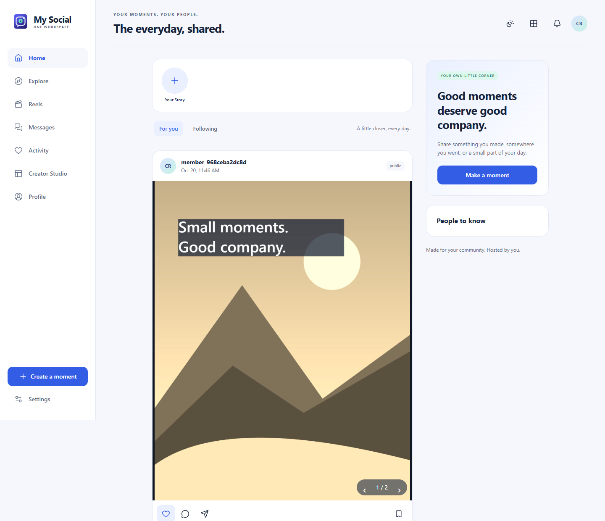
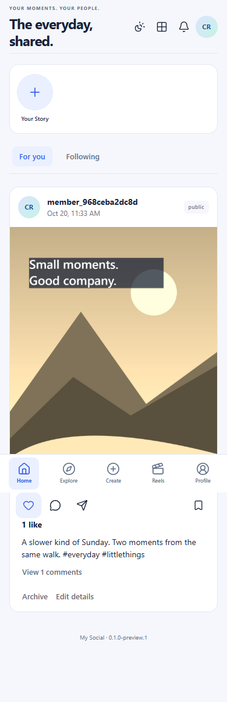

<p></p>

# My Social

Your moments. Your people. A self-hosted social PWA for **One Workspace**.

Capture a photo, make it yours with layered text and stickers, save an editable
draft, and share it with your community. Follow people, publish Stories and
bounded Reels, join the comments, and keep your originals on your own host.

**Functional Windows evaluation preview. Full Instagram parity is unfinished.**
See [acceptance and gaps](docs/ACCEPTANCE.md) before installation.



## Download and install

Use the [One Workspace installer](https://github.com/oneworkspacestudio/one-workspace/releases)
preview48 or later and select **My Social**, or download
[My Social releases](https://github.com/oneworkspacestudio/my-social/releases).
The single `MySocial.exe` embeds its React UI and SQLite runtime. No Docker,
external database or Node runtime is required. FFmpeg/FFprobe are optional
centrally configured helpers for video publishing; see [operations](docs/OPERATIONS.md).

MyAccounts provides the managed sign-in. Originals reside under the configured
**My Photos / My Social** adapter, keyed by immutable issuer/subject identity.
Private originals never become public folder links; publishing shares mediated
renditions with the chosen audience. Public means signed-in community members.

## Create and connect

- Mobile navigation, desktop rail, shared Workspace appearance and branded PWA.
- Explicit camera/mic controls and capability-based fallbacks.
- Editable Fabric scenes, crop/filters, multiline text, emoji, drawing and layers.
- Independent carousel edits, crash recovery, private drafts and exact preview.
- Stories with 24-hour server expiry, polls, replies and permanent Highlights.
- Structured, bounded FFmpeg Reel rendering with trim, order and speed controls.
- Profiles, follow approval, blocks, feed/Explore, likes, saves and comments.
- Creator Studio, scheduling, reports, owner moderation, account export/disable.
- Durable activity, SSE, opt-in private VAPID Web Push and app-shell offline use.

My Chat has an explicit app launcher. Social DMs/calls, Live, commerce, licensed
music and automatic captions are unavailable. The UI describes these limits.
Offline publishing is not promised; reconnect and retry from a retained draft.



## Build

Windows, Go 1.27.2 and Node 24+ are development tools. Runtime does not use Node.

```powershell
npm --prefix web ci --ignore-scripts
node web/scripts/icons.mjs
npm --prefix web run build
go test ./...
go build -o MySocial.exe ./cmd/my-social
```

Keep account/test state on NTFS. `scripts/build.ps1` also inventories licences,
embeds the original Windows icon, and packages versioned binary/source archives.
GitHub Actions runs native Windows tests and the synthetic Chrome workflow.

Read [architecture and discovery](docs/PLAN.md), [operations and retention](docs/OPERATIONS.md),
[security](SECURITY.md), and [acceptance](docs/ACCEPTANCE.md).

Apache-2.0. Fabric.js, Lucide, Go and web dependencies retain their licences in
release notices. Original branding; no Meta/Instagram code, logo or media.
